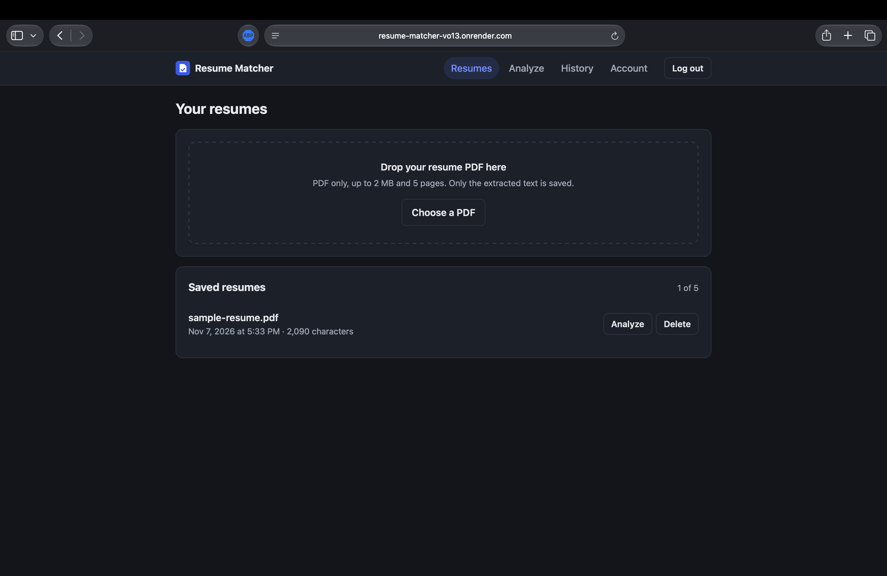
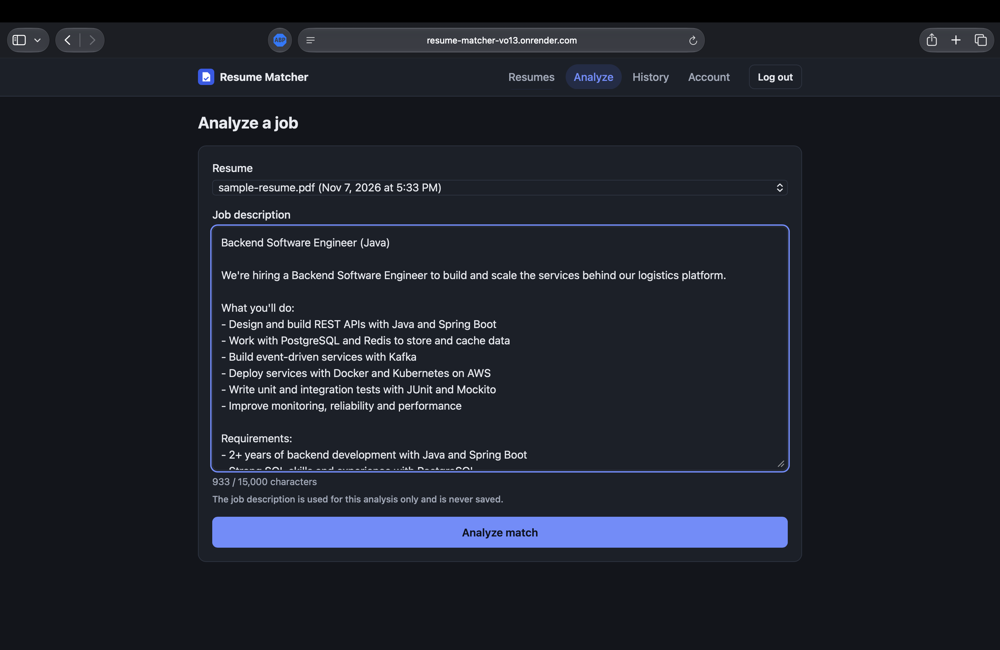
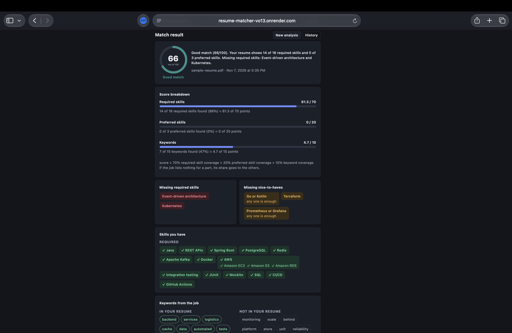
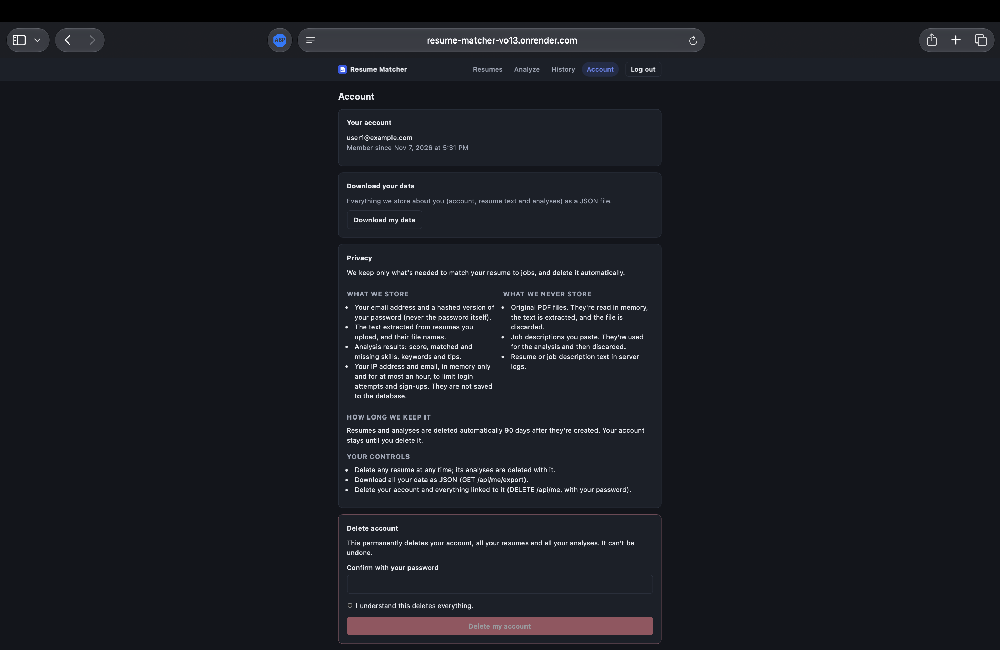
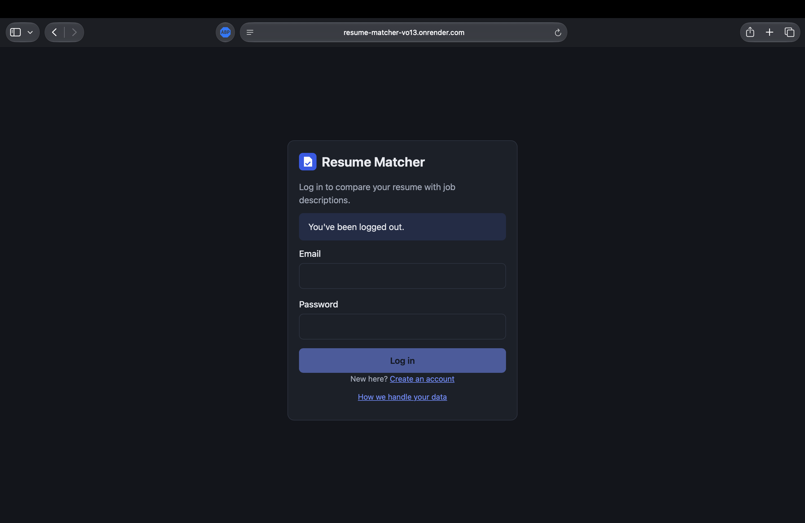
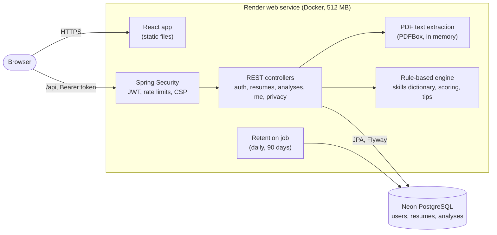

# Resume Matcher

[](https://github.com/HarshithMeda/resume-matcher/actions/workflows/ci.yml)

Upload your resume (PDF), paste a job description, and get a match score out of 100 that shows
exactly where every point came from: which required and preferred skills you have, which are
missing, which keywords overlap, and practical tips. The matching engine is rule-based, free to
run, and open source. It doesn't use AI and never writes experience for you.

**Live app: https://resume-matcher-vo13.onrender.com**

- **Register your own account.** There's no shared demo login on purpose: people might upload real
  resumes, and a shared account would let every visitor see them.
- **No resume handy?** Use the made-up sample resume [`docs/sample-resume.pdf`](docs/sample-resume.pdf)
  ("Riley Example", a fictional backend engineer) and paste any job posting.
- **The first load can take about a minute.** The app runs on Render's free plan, which sleeps
  after 15 minutes without traffic; the first request wakes it (Java starting on a small slice of
  CPU) and the free Neon database may need a moment to wake too. After that it's quick.

## Screenshots

| Upload resumes | Analyze a job |
|---|---|
|  |  |

| Match result | Account and privacy |
|---|---|
|  |  |

<details>
<summary>Login page</summary>



</details>

## Features

- **PDF upload** with text extraction in memory. Only the extracted text is saved, never the file.
  Up to 5 resumes per account; PDFs up to 2 MB and 5 pages.
- **Match analysis** against a pasted job description (50 to 15,000 characters):
  - a score out of 100 with a band (Strong 80+, Good 60+, Partial 40+, Weak),
  - a breakdown showing how each part of the score was calculated,
  - required and preferred skills, split into matched and missing,
  - "either-or" groups ("Power BI or Tableau: any one is enough", with the one you matched),
  - skill groups ("AWS (EC2, S3)") and implied skills (a resume listing Spring Boot also shows Spring Framework),
  - keywords from the posting that are and aren't in your resume,
  - up to 5 tips.
- **History** of past analyses, each with the resume it used.
- **Privacy controls:** download all your data as JSON, delete a resume (its analyses go with it),
  delete your account with your password, and automatic deletion after 90 days.
- **Accessible, responsive React frontend** served by the same app as the API.

## How the matching works

Everything is plain rules you can read in
[`analysis/engine`](src/main/java/com/harshith/resumematcher/analysis/engine): no AI model, no paid
API, and the same input always gives the same result.

1. **Find skills in the job posting.** A dictionary of about 215 skills in 15 categories
   ([`skills.json`](src/main/resources/analysis/skills.json)) lists each skill's names and common
   wordings: languages, frameworks, databases, cloud, DevOps, testing, data, business analysis,
   product management, certifications and explicitly named soft skills. Matching respects word
   boundaries, tries longer names first ("GitHub Actions" isn't also counted as "GitHub"), and handles
   case-sensitive names like "Go" and "R".
2. **Decide what's required and what's preferred.** Each skill takes its importance from the section
   it's in ("Requirements", "Nice to have", "Bonus", and so on) and from the sentence's wording
   ("preferred", "a plus", "familiarity with is helpful"). Skills joined by "or" or "/" become one
   group that any of them satisfies.
3. **Check the resume.** Each job skill is looked up in the resume text the same way. Parent skills
   are satisfied by their parts (Amazon EC2 shows AWS experience), and some skills imply others
   (Spring Boot implies Spring Framework), labelled "implied by" so it's clear why they count.
4. **Compare keywords.** Up to 15 meaningful words from the posting (not skills, not filler like
   "team" or "ensure", not names written only in capitals) are compared with the resume using simple
   word forms, so "processes" and "processing" are one keyword.
5. **Score:**

   ```
   score = 70 × (required skills found  / required skills in the job)
         + 20 × (preferred skills found / preferred skills in the job)
         + 10 × (keywords found         / keywords picked)
   ```

   If the job lists nothing for a part (for example, no preferred skills), that part's points are
   shared among the others in proportion, so the score is still out of 100. The result page shows
   each line of this sum.
6. **Tips** come from fixed templates about what's missing, always conditional: "If you've used
   Kubernetes, add it to your skills section and mention where you applied it." They never write
   experience for you.

The engine sits behind two interfaces, `MatchAnalyzer` and `SuggestionProvider`, so another
implementation could replace it without changes to the rest of the app.

## How it compares with tools like Jobscan

Commercial resume scanners such as Jobscan do a lot this project doesn't: checks for specific
applicant tracking systems, much larger skill databases, formatting checks, and integrations. Resume
Matcher aims for a different set of goals:

| | Resume Matcher |
|---|---|
| **Explainable scoring** | One published formula. Every point on the result page traces back to a listed skill or keyword, and the rules are in this repository. |
| **Never invents experience** | It only reports what's in your resume and what's missing. Tips are conditional ("if you've used X…") and nothing is rewritten or generated. |
| **Privacy-first** | The PDF file is never stored, job descriptions are never stored, nothing is sent to an AI or analytics service, data is deleted after 90 days, and you can export or delete everything yourself. |
| **Free and open source** | No paid tiers or scan limits beyond basic abuse protection. Anyone can read the code, run it locally, or change the rules. |

The trade-off is that a rule-based engine only knows the skills and wordings in its dictionary (see
[Known limitations](#known-limitations)).

## Privacy design

Resumes contain personal information, so the app keeps as little as possible, for as short a time
as possible.

**What's stored** (in PostgreSQL):

- your email address and a BCrypt hash of your password (never the password itself),
- the text extracted from your resumes and their file names,
- analysis results: score, matched and missing skills, keywords and tips.

**What's never stored:**

- the original PDF files: they're read in memory, the text is extracted, and the file is discarded,
- job descriptions: they're used for one analysis and then discarded,
- resume text, job description text and file names in server logs. PDF library logging is switched
  off, and request errors don't log submitted values.

**Kept in memory only:** IP addresses and emails used by the rate limits, for at most an hour, never
written to the database.

**Retention and controls:**

- Resumes and analyses are deleted automatically 90 days after they're created (a daily job at 03:00).
  Your account stays until you delete it.
- **Export:** `GET /api/me/export` (the "Download my data" button) returns everything stored about you as JSON.
- **Delete:** remove any resume (its analyses go with it), or delete your account and everything linked
  to it with your password.
- Login tokens stop working as soon as the account is deleted.
- The same notes are shown in the app and at `GET /api/privacy`.

## Architecture



One Docker image holds both the React frontend and the Spring Boot API, so the site and the API share
an origin and there's no CORS to configure. The database schema is created by Flyway migrations and
checked by Hibernate at startup.

## Tech stack

| Area | Tools |
|---|---|
| Backend | Java 21, Spring Boot 4.1 (Web MVC, Security, Data JPA, Validation, Actuator), OAuth2 resource server with HS256 JWTs, BCrypt |
| Database | PostgreSQL 17, Flyway migrations, Hibernate |
| PDF | Apache PDFBox 3 |
| Frontend | React 19, TypeScript, Vite, React Router |
| Tests | JUnit 5, AssertJ, Testcontainers (real PostgreSQL), Vitest, Testing Library |
| Quality | ESLint with typescript-eslint, TypeScript type checking |
| Build and deploy | Maven, multi-stage Dockerfile (small JRE image, non-root user, class data sharing for faster startup), Docker Compose, GitHub Actions, Render, Neon |
| API docs | springdoc OpenAPI / Swagger UI (on locally, off in production unless `SWAGGER_ENABLED=true`) |

## API

All endpoints except auth, privacy and health need an `Authorization: Bearer <token>` header with the
token from login. Errors come back as JSON with a status and a message.

| Method | Path | What it does |
|---|---|---|
| `POST` | `/api/auth/register` | Create an account (email, password of 8 to 72 characters) |
| `POST` | `/api/auth/login` | Log in; returns a token valid for 60 minutes |
| `GET` | `/api/me` | Your account details |
| `GET` | `/api/me/export` | Download all your data as JSON |
| `DELETE` | `/api/me` | Delete your account and everything linked to it (needs your password) |
| `POST` | `/api/resumes` | Upload a resume PDF (multipart field `file`) |
| `GET` | `/api/resumes` | List your resumes |
| `GET` | `/api/resumes/{id}` | One resume, including its extracted text |
| `DELETE` | `/api/resumes/{id}` | Delete a resume and its analyses |
| `POST` | `/api/analyses` | Analyze a resume against a job description |
| `GET` | `/api/analyses` | List your analyses |
| `GET` | `/api/analyses/{id}` | One analysis with the full result |
| `GET` | `/api/privacy` | The privacy notes as JSON |
| `GET` | `/actuator/health/liveness` | Health check used by Render |

When the app runs locally, Swagger UI at http://localhost:8080/swagger-ui.html lists every request
and response in detail.

## Rate limits

To protect a free, public service from abuse:

| Action | Limit |
|---|---|
| Failed logins for one email | 5 per 15 minutes |
| Failed logins from one IP address | 20 per 15 minutes |
| Sign-ups from one IP address | 5 per hour |
| Analyses per user | 30 per day |

Going over a limit returns `429 Too Many Requests` with a `Retry-After` header. The limits are kept in
memory (see [Known limitations](#known-limitations)). On Render, the client's IP is read from
`X-Forwarded-For` only when the request comes through Render's and Cloudflare's proxies, and at most
two proxy hops are skipped, so a client can't fake their address by sending the header themselves.

## Testing and CI

- **Backend:** 165 tests. Unit tests cover the matching engine, scoring, word forms, rate limiters and
  client-IP handling. Integration tests start the whole app against a real PostgreSQL 17 in a
  Testcontainers container. They cover sign-up and login, uploads (including bad and oversized PDFs),
  analyses, rate limits, export, account deletion, retention, security headers and production
  settings.
- **Frontend:** Vitest and Testing Library tests for the pages and the result view, plus ESLint and
  TypeScript type checking.

[GitHub Actions](.github/workflows/ci.yml) runs three jobs on every push and pull request: **Tests
(Java 21)** (`./mvnw verify`), **Frontend** (lint, type check, tests, build), and **Docker image**
(builds the production image).

## Running locally

**With Docker Compose** (the simplest way; needs Docker):

```bash
cp .env.example .env    # then replace the placeholders with random values, e.g. openssl rand -hex 32
docker compose up --build
```

Open http://localhost:8080. Compose starts PostgreSQL 17 and the app with the same 512 MB memory
limit as the free Render plan. The image runs the production profile, so Swagger UI is off unless you
set `SWAGGER_ENABLED=true` in `.env`. Never commit `.env`.

**While developing:**

- run the API with `./mvnw spring-boot:run` (it reads database settings and a JWT secret from an
  optional, git-ignored `local.properties`),
- run the frontend with `cd frontend && npm install && npm run dev`, then open http://localhost:5173.
  The Vite dev server forwards `/api` to the API on port 8080.

**Tests:** `./mvnw verify` (needs Docker for Testcontainers), and
`cd frontend && npm run lint && npm run typecheck && npm test`.

## Deploying to Render (free plan) with Neon

Create a **Web Service** from this repository with the **Docker** runtime. The `Dockerfile` builds the
frontend and the API into one image and runs the `prod` profile.

**Health check path:** `/actuator/health/liveness`. It doesn't touch the database, so a sleeping Neon
database isn't woken every few seconds, and a slow database wake-up doesn't make Render restart the
app. `/actuator/health` still includes the database.

**Environment variables:**

| Variable | What to put in it |
|---|---|
| `SPRING_DATASOURCE_URL` | Neon's **direct** (not "pooled") connection as a JDBC URL: `jdbc:postgresql://<endpoint-host>/<database>?sslmode=require` |
| `SPRING_DATASOURCE_USERNAME` | The Neon role (database user) |
| `SPRING_DATASOURCE_PASSWORD` | That role's password |
| `APP_JWT_SECRET` | A long random string, at least 32 characters (e.g. `openssl rand -hex 32`). Changing it logs everyone out. |
| `SWAGGER_ENABLED` | Optional. `true` turns on Swagger UI and `/v3/api-docs`; leave it unset in production. |

Don't set `PORT` (Render sets it, and the app listens on whatever it says) or `SPRING_PROFILES_ACTIVE`
(the image already uses `prod`). Use Neon's direct host rather than the pooled one: Flyway migrations
need a regular session, and the app opens at most 5 connections anyway.

Memory is tuned for 512 MB: a capped heap, the serial garbage collector, at most 50 request threads
and a small connection pool. Measured locally under the same limits, memory peaked at about 250 MB.
Startup took about 75 seconds at 0.1 CPU.

## Known limitations

- **It only knows the skills in its dictionary.** A skill that isn't in
  [`skills.json`](src/main/resources/analysis/skills.json), or a resume that describes a skill in words
  that aren't on its list, won't be credited. The lists are kept fairly strict on purpose, so phrases
  like "continuous improvement" or "functional requirements" don't turn every developer posting into a
  business-analysis one. Skills are recognised by name, not by meaning: "built pipelines that deploy
  on every merge" doesn't count as CI/CD.
- **English only, text PDFs only.** Scanned or image-only PDFs are rejected with a clear message, as
  OCR isn't supported. Unusual layouts (text boxes, heavy columns) may extract in an odd order.
- **Keyword matching can match names.** Words the job posting only ever writes capitalized (company
  names like "Example Health Partners", or verbs that open bullets) are skipped as keywords. But a
  resume is compared word by word, including the candidate's name and past employers, so a keyword
  can occasionally show as matched because of a name. It only affects the keyword part (10%).
- **Either-or is read from the wording only.** Skills joined by "or" or a slash ("Power BI or
  Tableau", "Java/Kotlin", "AWS, Azure or GCP") count as one group that any of them satisfies. Lists
  joined by "and" don't, and a comma list only joins the group while its items are the same kind of
  skill ("Java, SQL, Docker or Kubernetes" groups just Docker and Kubernetes). Alternatives written
  in other ways ("one of: …", separate bullets) are still counted as separate skills, and a slash
  always means "or" (so "Agile/Scrum" is satisfied by either one).
- **Word forms use simple rules.** Keywords are compared by a rule-based base form ("process",
  "processes" and "processing" are one keyword; so are "document", "documented" and "documentation").
  It doesn't know irregular forms ("ran" vs "run") or every derived word ("automation" and "automate"
  stay different), and everyday verbs and filler words ("manage", "online", "team") are ignored.
- **Years of experience and seniority aren't checked.** "5+ years of Java" counts the same as "Java".
- **Rate limits are kept in memory.** Login, sign-up and daily analysis counts reset when the app
  restarts (including when the free instance sleeps), and each app instance counts separately. That's
  fine for a single instance; running several would need a shared store such as the database.
- **Client IPs on Render depend on Render's proxy setup.** Render doesn't document its headers. Based
  on Cloudflare's documentation (it appends the address that connected to it) and observed Render
  headers, the app reads `X-Forwarded-For` only from Render's private network and Cloudflare's
  published ranges, and skips at most two proxy hops from the right, so a client can't choose their
  own IP. If Render changes its proxy chain or Cloudflare adds ranges, the per-IP limits could end up
  shared by many users (too strict) until the lists in `application-prod.properties` are updated.
  The log line starting "Client IP:" after the first request shows whether the header looks as
  expected. Several people behind one network address (an office, a mobile carrier) also share one
  limit.
- **Accounts are basic.** There's no email verification and no password reset, and the login token
  is kept in the browser's local storage (a strict Content Security Policy limits the risk from
  injected scripts). Tokens expire after 60 minutes.
- **Free hosting is slow to wake.** After 15 idle minutes the first request takes about a minute.
